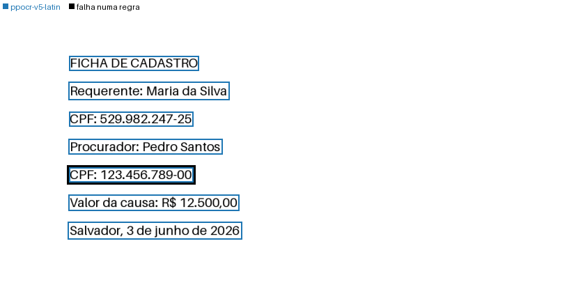

# docaudit

Lê documentos digitalizados em português do Brasil, confere a própria
leitura e diz de onde veio cada trecho.

- **Lê toda página com um leitor barato.** Usa a
  [camada de texto](glossary.md#camada-de-texto) do PDF onde ela existe e o
  OCR na CPU onde ela falta. Numa digitalização com
  [camada de OCR](glossary.md#camada-de-ocr), o OCR lê os pixels, e a
  camada fica como outra leitura.
- **Aponta o valor que não confere.** O dígito verificador de um CPF, de um
  CNPJ ou do número de um processo prova que o valor lido é inválido. Outra
  família de OCR pode reler essas páginas e separar o erro impresso do erro
  de leitura. Só o que continua sem explicação vai ao
  [leitor caro](glossary.md#leitor-caro), quando você passa um.
- **Devolve a origem de cada trecho.** Cada linha lida traz a página, a caixa
  na página e o leitor que a leu.

<div class="grid" markdown>



```text
[p0:2] CPF: 529.982.247-25
[p0:3] Procurador: Pedro Santos
[p0:4] CPF: 123.456.789-00
<!-- decisão: 1 x CPF que falha a verificação -->
- CPF: 529.982.247-25 · confirmed · p0:2
- CPF: 123.456.789-00 · failed · p0:4
```

</div>

A ficha da [primeira leitura](tutorial.md), lida pelo PP-OCR. À esquerda, a
imagem de `docaudit.visualize`: a cor da caixa diz o leitor, e o contorno
preto marca o CPF cujo dígito verificador não confere. À direita, um trecho
de `result.to_markdown(annotated=True)`.

!!! warning "Alpha"
    Nada foi publicado no PyPI ainda, e a API pode mudar. A instalação é pelo
    git, fixada num commit ou numa tag.

[Primeira leitura](tutorial.md){ .md-button .md-button--primary }
[Como funciona](concepts/index.md){ .md-button }

<div class="grid cards" markdown>

-   **Aprender**

    ---

    Instale o pacote e leia o primeiro documento em poucos minutos.

    [Instalação](install.md) ·
    [Primeira leitura](tutorial.md)

-   **Resolver um caso**

    ---

    Uma tarefa por página: mandar ao leitor caro só o que falhou, declarar os
    campos do seu documento, ligar um modelo de visão e linguagem.

    [Escalar só o que falhou](how-to/escalate.md) ·
    [Declarar os campos](how-to/checks.md) ·
    [Modelo de visão e linguagem](how-to/vlm.md) ·
    [Receitas](recipes/index.md) ·
    [Problemas comuns](troubleshooting.md)

-   **Entender**

    ---

    Por que a leitura é feita assim, quanto custa cada etapa e onde ela falha.

    [Como a leitura funciona](concepts/index.md) ·
    [Desempenho](performance.md) ·
    [Limites](limits.md)

-   **Consultar**

    ---

    Cada argumento, cada campo do resultado e cada nome público.

    [Configuração](configuration.md) ·
    [Formato da resposta](response/index.md) ·
    [API](reference/index.md) ·
    [Glossário](glossary.md)

</div>

??? note "In English"
    --8<-- "README.md:english"
