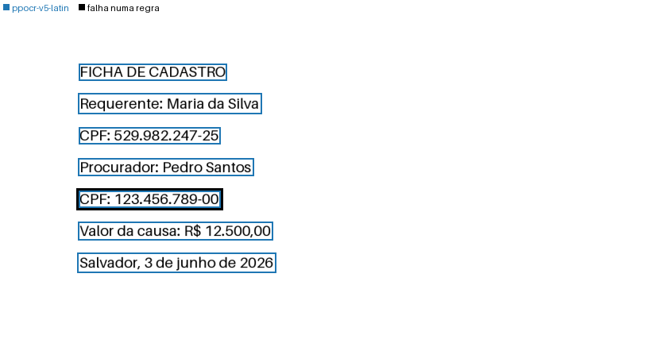

# Primeira leitura

Neste tutorial você monta a imagem de uma ficha com dois CPFs, lê a ficha
com o `docaudit` e vê qual dos dois não confere. No fim, desenha a caixa de
cada linha lida sobre a imagem. Leva poucos minutos e não precisa de
servidor de modelo.

Antes de começar, instale o pacote com o extra `ppocr`, como em
[Instalação](install.md). A primeira leitura baixa os pesos do PP-OCR, e por
isso precisa de rede uma vez.

## 1. Montar a ficha

Salve este programa como `ficha.py` e rode `python ficha.py`. Ele desenha
sete linhas numa imagem em branco e a grava como `ficha.png`.

```python
from PIL import Image, ImageDraw, ImageFont

# Uma ficha de 1240 por 620 pixels: a largura de uma folha A4 a 150 DPI.
image = Image.new("L", (1240, 620), color=255)
draw = ImageDraw.Draw(image)
font = ImageFont.load_default(size=28)

lines = [
    "FICHA DE CADASTRO",
    "Requerente: Maria da Silva",
    "CPF: 529.982.247-25",
    "Procurador: Pedro Santos",
    "CPF: 123.456.789-00",
    "Valor da causa: R$ 12.500,00",
    "Salvador, 3 de junho de 2026",
]
for i, text in enumerate(lines):
    draw.text((150, 90 + 60 * i), text, fill=0, font=font)

image.save("ficha.png", dpi=(150, 150))
```

O Pillow vem com o `docaudit`. A fonte que ele traz não tem letras
acentuadas, e por isso a ficha não tem acento.

O primeiro CPF é válido. O segundo tem o último dígito errado: os dígitos
verificadores de `123.456.789` são `09`, e a ficha traz `00`. É o tipo de erro que
o `docaudit` encontra sem nenhum texto de referência.

## 2. Ler a ficha

Abra o Python na mesma pasta e leia a imagem:

```pycon
>>> import docaudit
>>> result = docaudit.process("ficha.png", policy="evidence")
>>> result.pages[0].substrate
<Substrate.IMAGE_ONLY: 'image_only'>
```

`process` aceita um PDF ou uma imagem. A imagem vira um PDF de uma página.
O [substrato](glossary.md#substrato) `image_only` diz que a página não tem
[camada de texto](glossary.md#camada-de-texto), e por isso o PP-OCR a leu.

`policy="evidence"` confere cada linha lida com as verificações padrão, como
a do CPF, e encaminha ao leitor caro a página em que um valor falha. Sem
ela, vale a política `all_cheap`: as entidades saem do mesmo jeito, mas
nenhuma página é encaminhada.

## 3. Ver de onde veio cada trecho

O texto lido está em `result.chunks`, um [trecho](glossary.md#trecho) por
linha:

```pycon
>>> for chunk in result.chunks[:3]:
...     print(chunk.source, chunk.text)
...
ppocr-v5-latin FICHA DE CADASTRO
ppocr-v5-latin Requerente: Maria da Silva
ppocr-v5-latin CPF: 529.982.247-25
>>> chunk = result.chunks[4]
>>> chunk.text, chunk.page, chunk.source
('CPF: 123.456.789-00', 0, 'ppocr-v5-latin')
>>> chunk.bbox
BBox(x0=0.11925866236905722, y0=0.5362318840579711, x1=0.33521353746978244, y1=0.5861513687600645)
```

Cada trecho diz a página, o leitor que o leu e a [caixa](glossary.md#caixa)
onde está. A caixa vai de 0 a 1, com origem no canto superior esquerdo.
`chunk.bbox.to_pixels(1240, 620)` a converte para os pixels da ficha.

## 4. Ver o CPF que não confere

Os valores que as verificações acharam estão em `result.entities`:

```pycon
>>> for entity in result.entities:
...     print(entity.kind, entity.value, entity.state)
...
CPF 529.982.247-25 confirmed
CPF 123.456.789-00 failed
valor em reais R$ 12.500,00 well_formed
data por extenso 3 de junho de 2026 well_formed
```

Cada [entidade](glossary.md#entidade) tem um [estado](glossary.md#estado):

| estado | o que a regra diz |
|---|---|
| `confirmed` | o dígito verificador confere |
| `well_formed` | o valor está bem escrito, mas não tem dígito verificador |
| `failed` | o valor não pode estar certo |

Um valor `failed` tem uma de duas causas: o leitor errou, ou o erro está
impresso no documento. Aqui o erro está impresso. A
[releitura por outra família](glossary.md#releitura-por-outra-familia)
separa os dois casos.

A [decisão da política](glossary.md#decisao-da-politica) diz o que
aconteceu com a página:

```pycon
>>> decision = result.decisions[0]
>>> decision.tier, decision.reason
(<Tier.STRONG: 'strong'>, '1 x CPF que falha a verificação')
>>> for step in decision.steps:
...     print(step)
...
tier barato: ppocr-v5-latin leu 7 linha(s)
política: 1 x CPF que falha a verificação
sem leitor caro: fica a leitura barata
```

`tier` igual a `strong` quer dizer que a política
[encaminhou](glossary.md#encaminhar) a página ao
[leitor caro](glossary.md#leitor-caro). Como você não passou nenhum, a
página ficou com a leitura do PP-OCR. É o que diz o último passo.

## 5. Ver a leitura na página

`to_markdown(annotated=True)` dá o texto com uma referência curta em cada
linha, e no fim da página a decisão e as entidades:

```pycon
>>> print(result.to_markdown(annotated=True))
<!-- documento · PDF 1.4 -->
<!-- página 0 · ppocr-v5-latin -->
[p0:0] FICHA DE CADASTRO
[p0:1] Requerente: Maria da Silva
[p0:2] CPF: 529.982.247-25
[p0:3] Procurador: Pedro Santos
[p0:4] CPF: 123.456.789-00
[p0:5] Valor da causa: R$ 12.500,00
[p0:6] Salvador, 3 de junho de 2026
<!-- decisão: 1 x CPF que falha a verificação -->
- CPF: 529.982.247-25 · confirmed · p0:2
- CPF: 123.456.789-00 · failed · p0:4
- valor em reais: R$ 12.500,00 · well_formed · p0:5
- data por extenso: 3 de junho de 2026 · well_formed · p0:6
```

A referência `p0:4` aponta para a linha 4 da página 0. É a forma de entregar
a leitura a um modelo e conferir o que ele cita.

`visualize` desenha a caixa de cada linha sobre a imagem da página:

```pycon
>>> images = docaudit.visualize(result, "ficha.png")
>>> images[0].save("ficha-caixas.png")
```

Abra `ficha-caixas.png`:



A cor da caixa diz o leitor; a legenda fica na faixa de cima. O contorno
preto marca a linha cujo valor falha uma verificação.

## 6. Ler um PDF nato-digital

Este passo é opcional e baixa um PDF público do Tribunal de Justiça da
Bahia:

```bash
curl -L -o TR-Digitalizacao.pdf https://www.tjba.jus.br/portal/wp-content/uploads/2021/04/TR-Digitalizacao.pdf
```

Leia só a segunda página. O índice começa em zero:

```pycon
>>> tjba = docaudit.process("TR-Digitalizacao.pdf", pages={1})
>>> tjba.pages[0].substrate
<Substrate.BORN_DIGITAL: 'born_digital'>
>>> for chunk in tjba.chunks[:3]:
...     print(chunk.source, chunk.text)
...
text_layer 1 . OBJETO
text_layer A presente licitação tem como objeto CONTRATAÇÃO de empresa especializada na prestação
text_layer de SERVIÇOS DE DIGITALIZAÇÃO em formato PDF, com recebimento, armazenamento
```

A página é [nato-digital](glossary.md#nato-digital): o programa que gerou o
PDF compôs o texto. O leitor `text_layer` tirou as linhas da
[camada de texto](glossary.md#camada-de-texto), com os acentos, sem
renderizar a página e sem OCR.

## O que você viu

- `process` lê cada página na etapa barata: com a camada de texto onde ela
  existe, com o PP-OCR onde ela falta. Numa digitalização com camada de OCR,
  o PP-OCR lê os pixels.
- Cada trecho traz a página, a caixa e o leitor que o leu.
- As verificações acham CPFs, valores e datas, e dizem qual valor não pode
  estar certo.
- A política `evidence` encaminha ao leitor caro só a página com um valor
  que falha. Sem leitor caro, a leitura barata fica.

## Próximos passos

- [Escalar só o que falhou](how-to/escalate.md): passe um leitor caro e uma
  releitura por outra família.
- [Declarar os campos do seu documento](how-to/checks.md): uma verificação
  para um campo que o padrão não traz.
- [Formato da resposta](response/index.md): tudo o que volta em `Result`.
- [Como a leitura funciona](concepts/index.md): o porquê de cada etapa.
